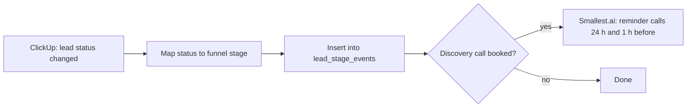
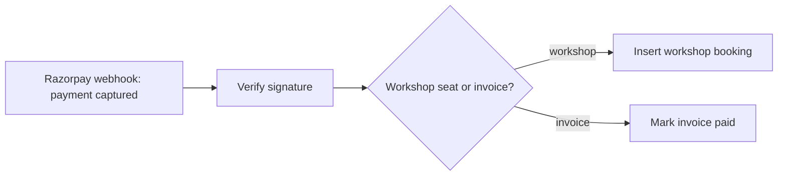
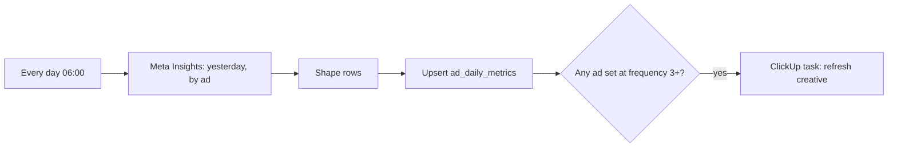
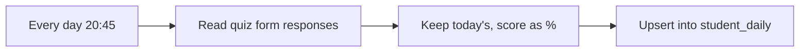
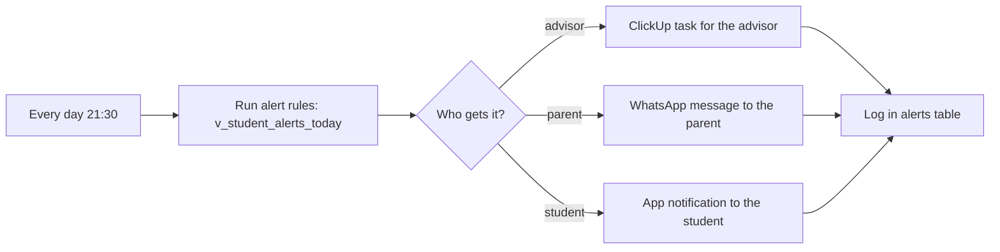
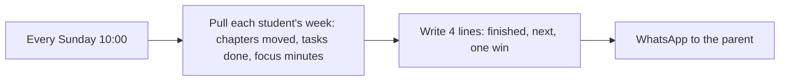

# n8n workflows

Five workflows move data into one Postgres database, so neither dashboard depends on anyone updating a sheet. Each JSON file in this folder can be imported into n8n (Workflows → Import from file). They are designs: they need Alcovia's ClickUp, Razorpay, Meta, WhatsApp and database credentials before they can run.

## GTM 1 · ClickUp lead stages → database
`gtm_1_clickup_lead_stages.json`

## GTM 2 · Razorpay payments → revenue tables
`gtm_2_razorpay_payments.json`

## GTM 3 · Daily Meta Ads pull (06:00 IST)
`gtm_3_meta_ads_daily.json`

## Students 1 · 8 pm quiz scores
`students_1_quiz_scores.json`

## Students 2 · Nightly alerts
`students_2_nightly_alerts.json`

Alert rules (in `sql/student_metrics.sql`): syllabus more than 25% behind plan, fewer than 60% of tasks on time, recovery under 40% for three days, five of the last seven quizzes skipped.

## Planned next · Sunday parent note

